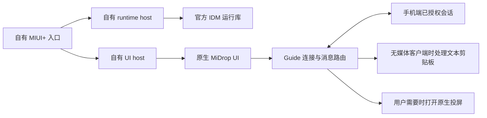

# 结构与边界

自有 C# 宿主提供直接启动、重复启动激活、取消、生命周期管理及离线文件验证。
原生 UI、连接、消息路由、剪贴板和媒体功能仍来自使用者本地提供的小米组件。

宿主使用自己的 Job 和父进程身份约束清理范围，启动前核对固定文件清单、组件版本、
管道字段和宿主身份。每个进程仍独立校验它要加载的候选文件。
私有管道名称用于区分本地副本，不是认证密钥，也不保证网络端口或系统数据完全隔离。

原始客户端的账号头像入口和两条已确认的自动账号初始化入口已精简；
没有伪造 UID、登录成功状态或手机授权。IDM 对 MiSSO 的依赖仍存在，不能声称完全删除了账号相关实现。

本项目没有实现新的手机控制协议或独立 Android 服务。原生组件的锁屏、熄屏、
授权策略和固件差异仍然影响功能。保留版本条件和错误信息，不将静态修改描述为普遍兼容。

源码入口可自行编译；原生组件只通过本地精确版本补丁修改，不能从本仓库重新编译其完整实现。
